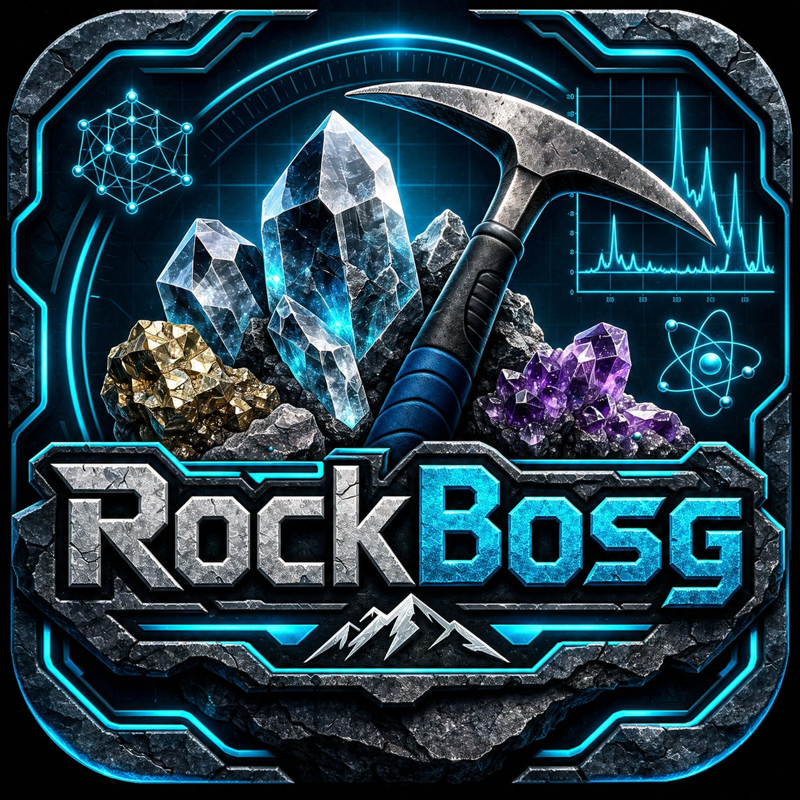

<p align="center">
  
</p>

<h1 align="center">RockBosg — Colección Gómez</h1>

<p align="center">
  Una Pokédex de rocas y minerales hecha para la familia Gómez:<br>
  para el abuelo, geólogo que trabajó décadas en minería, y para su nieto de 13 años que empieza a explorar.
</p>

<p align="center">
  <a href="https://github.com/bosc12/RockBosg/releases/latest"><b>⬇️ Descargar la última versión (APK)</b></a>
</p>

---

## ¿Qué hace?

- **Pokédex Gómez** — 119 especies (85 minerales, 14 rocas ígneas, 10 sedimentarias y
  10 metamórficas), cada una con su ficha y un dato curioso. Aparecen bloqueadas hasta que las capturas.
- **Capturar** — tomas una foto (cámara o galería), eliges qué es del catálogo (con filtros para
  identificar por dureza Mohs, brillo y color de raya) y guardas lugar, GPS, fecha, datos científicos y notas.
- **Dos modos**
  - *Explorador*: niveles, XP, 20 insignias y datos curiosos.
  - *Geólogo*: fichas técnicas con fórmula, grupo y sistema cristalino, y letra más grande.
- **Compartir** — exporta una piedra o la colección completa (con fotos) como `.zip`, mándala por
  WhatsApp y la otra persona la importa. Sirve también como respaldo.
- **Privada** — la colección vive **solo en tu teléfono**. Sin cuentas ni servidores.
  La app solo usa internet para revisar si hay una versión nueva en este repositorio.
- Tema claro y oscuro.

## Instalar (Android)

1. Abre [la última versión](https://github.com/bosc12/RockBosg/releases/latest) desde el teléfono y descarga el archivo `RockBosg-x.y.z.apk`.
2. Ábrelo. Si Android lo pide, permite *“Instalar apps de fuentes desconocidas”*.
3. Listo. Para actualizar, la app te avisa cuando hay una versión nueva (o en *Ajustes → Buscar
   actualizaciones*). Al instalar encima **no se borra tu colección**.

> 💡 Exporta un respaldo de vez en cuando (*Ajustes → Exportar toda mi colección*): si
> desinstalas la app o cambias de teléfono, ese `.zip` es tu colección.

## Para desarrolladores

Hecha con Flutter (probada con 3.24) para Android.

```bash
flutter pub get
flutter test
flutter build apk --release
```

Sin `android/key.properties`, la compilación se firma con la llave de depuración local.

### Publicar una versión nueva

1. Sube la versión en `pubspec.yaml` (`version: 1.0.1+2`) y en `lib/version.dart`.
2. Ejecuta `scripts/release.sh`: compila, crea el tag `v1.0.1` y publica la Release con el APK.

Las apps instaladas detectan la Release nueva y ofrecen descargarla. Todas las versiones deben
firmarse con **la misma llave** para que Android permita actualizar sin desinstalar.

### Estructura

| Ruta | Contenido |
|------|-----------|
| `lib/data/catalog.dart` | Catálogo de especies: datos técnicos y curiosidades |
| `lib/data/achievements.dart` | Insignias, XP y niveles |
| `lib/data/db.dart`, `specimen.dart` | Base de datos local (SQLite) |
| `lib/services/exchange.dart` | Exportar / importar `.zip` |
| `lib/services/updater.dart` | Aviso de versión nueva (GitHub Releases) |
| `lib/screens/` | Pantallas |

¿Encontraste un dato mineralógico incorrecto? Abre un *issue*.

## Próximas ideas

- Identificación asistida por IA a partir de la foto.

## Licencia

El código está bajo licencia [MIT](LICENSE). Los nombres, logos e íconos **RockBosg** y **BOSG**
no están incluidos en la licencia (© BOSG, todos los derechos reservados). Ver [LICENSE](LICENSE).
